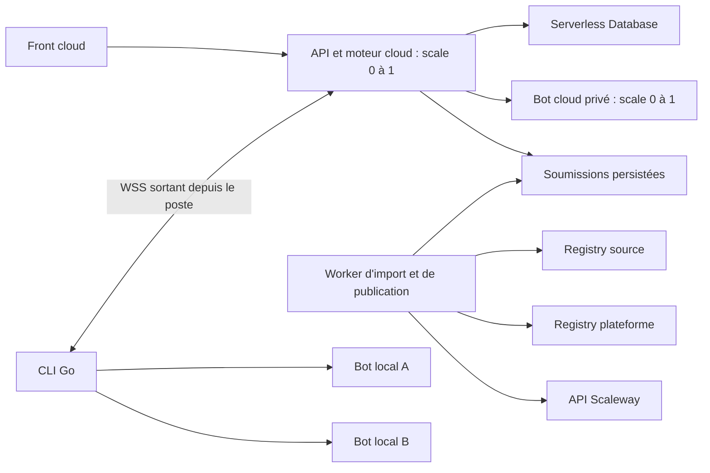

# Décisions et architecture

Date : 11 octobre 2026.

## Architecture retenue

L'API conserve les règles du jeu, les tours, les timeouts, la persistance et les événements de combat. Le CLI transporte les demandes et réponses HTTP des bots. Le navigateur ne contacte jamais `localhost`.

L'import des images s'effectue dans un worker de confiance distinct des bots. Sa réalisation peut être un Serverless Job à la demande. La contrainte scale 0 à 1 concerne les Serverless Containers ; pour les Jobs, limiter séparément la concurrence d'import, initialement à un.

La limite 512 Mo / 0,5 vCPU concerne les bots. Le dimensionnement de l'API Java et du worker reste à mesurer ; ne pas leur appliquer implicitement le budget d'un bot. La base et l'Object Storage ne suivent pas les paramètres d'autoscaling des containers.

## Isolation acceptée pour la première version

Les bots tiers s'exécutent dans des containers privés avec la sandbox du fournisseur, sans secrets applicatifs injectés et sans accès au Private Network hébergeant la base. Leur accès entrant est réservé à la plateforme via IAM Scaleway.

Le trafic sortant Internet reste possible. Un proxy ou un sidecar ne constitue pas une restriction si le bot peut ouvrir des connexions directes. Aucune configuration documentée répondant à ce besoin n'a été identifiée dans Serverless Containers ; ne pas présenter l'absence de sortie comme une garantie. [Réseau Scaleway](https://www.scaleway.com/en/docs/serverless-containers/reference-content/containers-private-networks/)

Les contrôles automatiques prouvent le respect des cas vérifiés et la compatibilité observée. Ils ne prouvent pas l'innocuité de code arbitraire. Prévoir suspension d'un bot, limites de soumissions et de consommation, rétention bornée des logs et nettoyage des ressources en échec.

## Exécution et équité

Une ressource de bot cloud, ou une déclaration de bot local, est réservée par un seul combat pendant toute sa durée. `max-scale=1` ne garantit pas cette exclusivité : il faut une réservation applicative atomique, libérée après succès, échec ou annulation, et récupérable après crash.

En V1, proposer un refus explicite « bot occupé », plutôt qu'une file de combats supplémentaire. Réserver les deux bots dans une même opération ; ne jamais laisser le premier réservé si le second est indisponible. La validation d'une nouvelle image et le redéploiement prennent également une réservation exclusive du bot cloud.

Pour les bots locaux, le CLI refuse deux déclarations actives de la même URL normalisée et le serveur empêche de sélectionner deux fois le même `bindingId`. Deux URL distinctes pouvant masquer le même processus ne sont pas détectables de façon fiable ; les tests locaux restent non compétitifs.

Le temps autorisé d'une action est mesuré par le serveur et inclut le réseau. Le code actuel fixe les règles standard à 2 000 ms, 100 tours, 10 points de vie et 10 actions interdites (`GameRules.java`). Conserver ces règles. Les mesures du CLI sont uniquement diagnostiques.

Le démarrage à froid d'un bot doit précéder le début du combat et être distingué du calcul d'une action. Le contrôle `/info` actuel est également limité à 2 secondes : ajouter une préparation explicite avant le lancement du moteur, sans augmenter silencieusement les règles du jeu. Le budget de préparation sera fixé après mesure.

Un bot doit accepter les redémarrages et ne pas dépendre d'un état mémoire durable. Un bot local tourne sur le matériel de son auteur : le relais ne reproduit pas les limites cloud. La validation de publication dans le budget cloud reste nécessaire.

## Conséquences du scale 0 à 1 pour l'API

Une seule instance permet un registre de connexions WebSocket en mémoire. Cela ne dispense pas de gérer les redéploiements et remplacements d'instance : les connexions et appels en cours sont perdus lors d'un remplacement.

Une connexion persistante peut maintenir l'API active et facturée. Scale minimum zéro ne signifie pas coût nul tant que des CLI restent connectés. Déconnecter les sessions inactives selon une politique à fixer.

Les jobs de combat doivent rester récupérables en base. Vérifier que le travail en arrière-plan Spring Batch continue correctement après la requête HTTP initiale sur l'hébergement serverless ; ne pas présumer qu'un thread interne suffit à maintenir une invocation active. Une session WebSocket ne résout pas le cas des combats cloud/cloud sans CLI. La stratégie d'invocation longue ou de worker de combat doit être validée avant déploiement.

## État du projet et travaux nécessaires

Le CLI Go existe dans `cli/` et vérifie déjà `/info` et `/play`. Le moteur Java appelle ces endpoints à travers `BotWebService`. Le labo actuel dans `application-frontend/src/routes/lab/+page.svelte` utilise des URL appelées directement par l'API ; `GameService.createLocalGame` ne les accepte que sur une instance locale.

Créer un parcours de tests distants authentifié, fondé sur des identifiants de bots locaux, sans activer le mode URL arbitraire en production. Introduire un transport de bot commun avec deux implémentations : HTTP cloud et relais WebSocket. Les règles du moteur restent communes. Voir le [protocole du labo](03-labo-websocket.md).

## Points ouverts

- Taille maximale compressée et décompressée des images ; nombre maximal de couches.
- Registries source autorisés ; V1 recommandée : registries publics autorisés explicitement, sans credentials utilisateurs.
- Région Scaleway ; proposition initiale `fr-par`.
- Port du bot : proposition 9000 et variable `PORT`, avec base `/api/v1/bots`, comme les templates actuels.
- Conversion exacte de « 512 Mo » vers l'unité de l'API Scaleway choisie ; éviter une confusion MB/MiB lors de l'implémentation.
- Budgets de préparation à froid, limites des messages, durées de session et rétention.
- Dimensionnement de l'API et du worker, stratégie d'exécution des jobs longs et preuve WebSocket sur Scaleway.
- Politique de visibilité des combats de labo. Proposition : accès réservé au propriétaire en V1, y compris REST et SSE.

Ces valeurs n'ont pas été décidées par l'utilisateur. Les propositions servent de base à l'implémentation et doivent rester identifiées comme telles.
